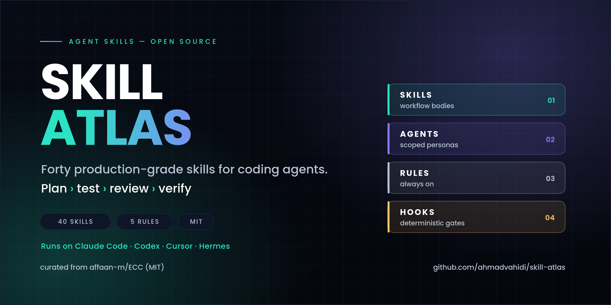

<div align="center">



**چهل اسکیل از میان سیصد و چهارده اسکیل، با انتخاب و نقشه راه خودمان.**

[](LICENSE)
[](skills/)
[](docs/catalog.md)

[English](README.md) · [معماری](docs/architecture.md) · [کاتالوگ کامل](docs/catalog.md)

</div>

---

<div dir="rtl" align="right">

## این مخزن چرا هست

ایجنت کدنویسی بدون متدلوژی، سریع‌ترین راه برای نوشتن کدی است که هیچ‌کس نمی‌تواند ریویو کند. راه‌حل هم
مدل بهتر نیست؛ یک **ترتیب کار** است که هارنس نمی‌تواند از آن رد شود: اول پلن، بعد تستِ شکست‌خورده، بعد
پیاده‌سازی حداقلی، بعد ریویو توسط کسی جز نویسنده، و در آخر گیت‌هایی که واقعاً اجرا شده‌اند.

پروژه [ECC](https://github.com/affaan-m/ECC) سیصد و چهارده اسکیل از این جنس دارد. بیشترشان عالی‌اند و
بیشترشان برای هر پروژه‌ای لازم نیستند (پرونده پزشکی، پرداخت x402، هارمونی‌او‌اس). اینجا **چهل اسکیلی**
نگه داشته شده که روی کار مهندسی روزمره واقعاً اثر می‌گذارد — با همان متن اصلی و لایسنس MIT.

کاری که مال ماست: انتخاب، نقشه، و ابزار. هر `SKILL.md` دست‌نخورده از بالادست است.

## داخلش چیست

| گروه | تعداد | کِی اول همین را لود کن |
|---|:--:|---|
| [**ورک‌فلو**](skills/workflow) | ۱۳ | داری کد را عوض می‌کنی و هنوز تستی ننوشته‌ای |
| [**ایجنت و AI**](skills/agents-ai) | ۸ | داری یک محصول ایجنتی می‌سازی، می‌سنجی یا آدیت می‌کنی |
| [**بک‌اند و داده**](skills/backend-data) | ۶ | اسکیمای دیتابیس، مایگریشن، کش یا مسیر خطا درگیر است |
| [**زبان‌ها و رانتایم**](skills/languages-runtime) | ۶ | قرارداد تست/کانتینر یک استک خاص را می‌خواهی |
| [**فرانت‌اند و دیزاین**](skills/frontend-design) | ۴ | کار روی UI، توکن‌های دیزاین یا دسترس‌پذیری است |
| [**محصول و محتوا**](skills/product-content) | ۳ | کار روی دیسکاوری، سئو یا انتشار است |

## سه دستور برای شروع

```bash
git clone https://github.com/ahmadvahidi/skill-atlas.git && cd skill-atlas
chmod +x tools/install-skill.sh
cp -R skills/workflow/* ~/.claude/skills/        # یا یک گروه کامل
./tools/install-skill.sh --list                  # بقیه‌ی ۲۷۴ اسکیل بالادست
./tools/install-skill.sh laravel-security        # هر وقت پروژه لازمش کرد
```

مسیر اسکیل‌ها: کلود کد `~/.claude/skills/` · کدکس `~/.codex/skills/` · کرسر `‎.cursor/rules/` · هرمس
`~/.hermes/skills/<دسته>/<نام>/SKILL.md`.

## پنج قاعده‌ای که این مجموعه حولش ساخته شده

۱. **قبل از اجرا، پلن.** تغییر پیچیده بدون پلن نوشته‌شده (فازها، ریسک‌ها، فایل‌ها) شروع نمی‌شود.
۲. **TDD واقعی.** تستی که نوشته شده ولی اجرا نشده، RED نیست. کامپایل، اجرا، و دیدن شکستِ درست الزامی است؛
   بعد حداقل کد برای GREEN، بعد ریفکتور با کف پوشش ۸۰٪.
۳. **یک ورودی، یک خروجی در هر فاز.** research → plan → implement → review → verify؛ خروجی‌ها در فایل،
   هیچ فازی حذف یا ادغام نمی‌شود، و ریویوور همان نویسنده نیست.
۴. **گیتی که اجرا نشده، باید «دستی» اعلام شود.** گفتن «همه چیز پاس شد» وقتی پنج مورد انسانی بوده، از
   یک چک‌لیست کوتاه‌تر بدتر است.
۵. **هر کشف غیرپیش‌پاافتاده برمی‌گردد داخل همان اسکیلی که شکست خورد** — همان لحظه، نه در حافظه‌ی سشن بعد.

نسخه‌ی بلند (اقتصاد توکن، `pass@k` در برابر `pass^k`) در [docs/architecture.md](docs/architecture.md).

## چه چیزی اینجا نیست

۲۷۴ اسکیل بالادست نصب نشده‌اند: نسخه‌های هر زبان (Java، Kotlin، Swift، PHP، C#، Dart، C++، F#، Perl…)،
الگوهای صنایع تنظیم‌شده (HIPAA، پرونده بالینی)، تریدینگ و پرداخت، تمپلیت‌های کانفیگ شبکه، و آزمایش‌های
برند/مارکتینگ. همه با یک خط توضیح و حجم در [docs/catalog.md](docs/catalog.md) فهرست شده‌اند.

## منشأ و لایسنس

- برگرفته از [affaan-m/ECC](https://github.com/affaan-m/ECC) — لایسنس MIT، کامیت `b38be6a` (۲۰۲۶-۱۰-۲۹).
- نویسنده‌ی بالادست: Affaan Mustafa، برنده‌ی هکاتون Anthropic × Forum Ventures.
- این مخزن **وابسته به آن پروژه نیست** و تأییدیه‌ای از آن ندارد؛ انتخاب، مستندات و ابزار مال ماست.
  جزئیات در [NOTICE](NOTICE) و متن لایسنس در [LICENSE](LICENSE).

</div>

<div align="center">
<sub>ساخته و نگهداری‌شده توسط <a href="https://github.com/ahmadvahidi">احمد وحیدی</a> · تصاویر از <code>tools/render_assets.py</code> ساخته می‌شوند · MIT</sub>
</div>
