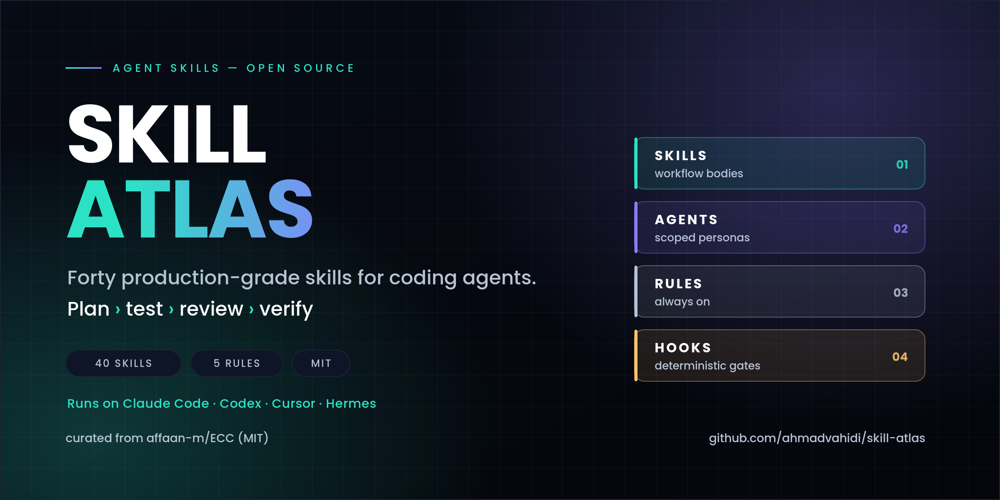
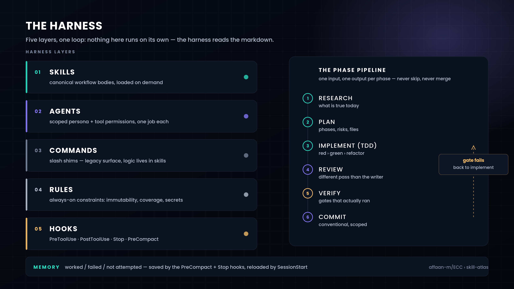
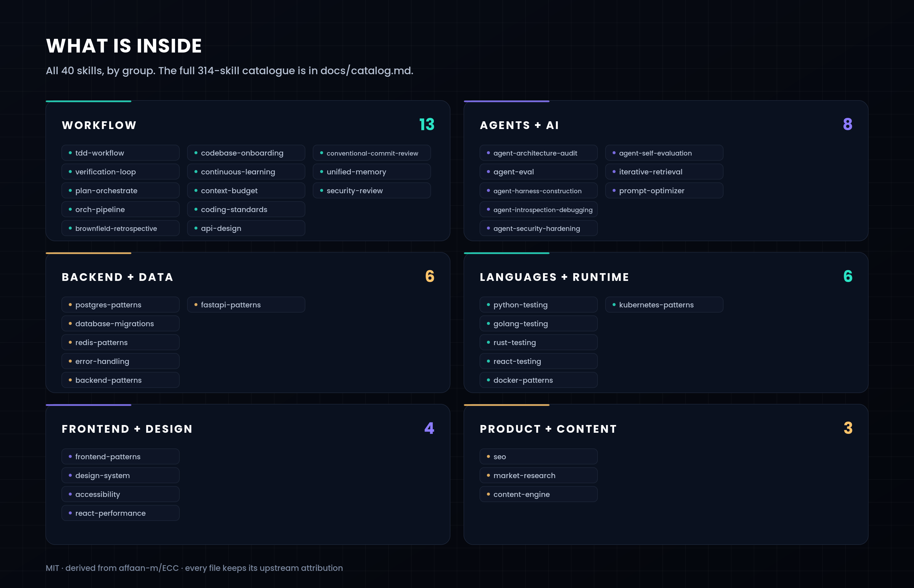

<div align="center">



**The forty skills worth installing, out of three hundred and fourteen.**

[](LICENSE)
[](skills/)
[](docs/catalog.md)
[](#contributing)

[Architecture](docs/architecture.md) · [Catalogue](docs/catalog.md) · [فارسی](README.fa.md)

</div>

---

## Why this exists

A coding agent with no methodology is a very fast way to write code nobody can review. The fix is not a
better model — it is a workflow the harness cannot skip: a plan before the edit, a failing test before the
implementation, a reviewer that is not the author, and gates that actually ran.

[ECC](https://github.com/affaan-m/ECC) collects 314 such workflows. Most of them are excellent and most of
them are irrelevant to any given project (healthcare EDI, x402 payments, HarmonyOS ArkTS). This repository
keeps the **40 that change outcomes across ordinary engineering work**, keeps them in the format every major
harness already reads, and documents the reasoning in [docs/architecture.md](docs/architecture.md).

Nothing here is generated filler: every `SKILL.md` is upstream's text, unedited, with its MIT attribution
intact. What is ours is the selection, the map, and the tooling.

<div align="center">

</div>

## The forty, by group

<div align="center">

</div>

| Group | Skills | Load this first when… |
|---|:--:|---|
| [**Workflow**](skills/workflow) | 13 | you are about to change code and have not written a test |
| [**Agents + AI**](skills/agents-ai) | 8 | you are building, auditing or evaluating an agent product |
| [**Backend + Data**](skills/backend-data) | 6 | schema, migrations, caches or error paths are involved |
| [**Languages + Runtime**](skills/languages-runtime) | 6 | you need the test/container conventions of one stack |
| [**Frontend + Design**](skills/frontend-design) | 4 | the work is UI, design tokens or accessibility |
| [**Product + Content**](skills/product-content) | 3 | the work is discovery, SEO or publishing |

## Start in three commands

```bash
git clone https://github.com/ahmadvahidi/skill-atlas.git && cd skill-atlas
chmod +x tools/install-skill.sh
./tools/install-skill.sh --list                      # everything upstream has
cp -R skills/workflow/* ~/.claude/skills/            # or take a whole group
```

Per harness:

| Harness | Where skills live | Note |
|---|---|---|
| Claude Code | `~/.claude/skills/<name>/SKILL.md` | read on demand; no install step beyond the copy |
| Codex CLI | `~/.codex/skills/` | same `SKILL.md` shape |
| Cursor | `.cursor/rules/` (project) | copy the body as a rule, or keep a skills dir and reference it |
| OpenCode | `~/.config/opencode/skill/` | same markdown, project overrides user |
| Hermes | `~/.hermes/skills/<category>/<name>/SKILL.md` | frontmatter `name` + `description` are the only required fields |

A skill costs context only when it is loaded. Installing forty is cheap; enabling forty MCP servers is not.

## The five rules this collection is organised around

1. **Plan before execute.** A complex change gets a written plan — phases, risks, files — before any edit.
2. **TDD, for real.** A test that was written but never executed is not RED. Compile it, run it, watch it fail
   for the intended reason, then implement the minimum that turns it green, then refactor with coverage as
   the floor (80%).
3. **One input, one output per phase.** Research → plan → implement → review → verify. Outputs go into files,
   phases are never skipped and never merged, and the reviewer is a different pass than the writer.
4. **A gate that cannot run is named manual.** Reporting "all checks passed" while five items were human-only
   is worse than a shorter checklist.
5. **A non-trivial discovery goes back into the skill that failed** — immediately, not into next session's
   memory where it will be lost.

The long version, including token economics and `pass@k` vs `pass^k`, is in
[docs/architecture.md](docs/architecture.md).

## What is *not* here

274 skills stayed upstream: per-language variants (Java, Kotlin, Swift, PHP, C#, Dart, C++, F#, Perl, Scala),
regulated-industry patterns (HIPAA, PHI, clinical decision support), trading and payments (x402, AMM security,
prediction markets), network configuration templates, and the 60-odd brand/marketing experiments.

They are indexed with a one-line description and a line count in [docs/catalog.md](docs/catalog.md). When a
project actually needs one:

```bash
./tools/install-skill.sh laravel-security
```

## Provenance

- Derived from **[affaan-m/ECC](https://github.com/affaan-m/ECC)** (MIT), commit `b38be6a`, 2026-10-29.
- Upstream author: Affaan Mustafa — winner of the Anthropic × Forum Ventures hackathon.
- This repository is **not affiliated with or endorsed by** the upstream author. It is a curated subset with
  its own selection, documentation and tooling. See [NOTICE](NOTICE).
- Every vendored skill keeps its upstream frontmatter (`metadata.origin: ECC`); the licence text is in
  [LICENSE](LICENSE).

## Contributing

Good additions are skills that (a) encode a gate a reviewer can check, (b) are harness-agnostic markdown,
and (c) come with the failure they prevent described in one sentence. Open a PR with the skill, a line in the
right group's table, and — if you touched the artwork — a regenerated `assets/*.svg` (`python3 tools/render_assets.py`).

Not accepted: prompt-wrapper collections, anything that requires a paid API to be useful, and skills that
restate the title of their own section.

<div align="center">
<sub>Built and maintained by <a href="https://github.com/ahmadvahidi">Ahmad Vahidi</a> · artwork generated from <code>tools/render_assets.py</code> · MIT</sub>
</div>
